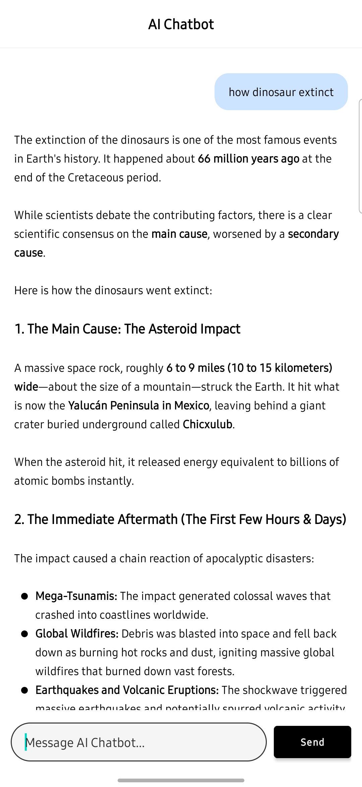

# AI Chatbot for Android 🤖

A sleek, minimalistic Android Chatbot application powered by Google's **Gemini AI API** (`gemini-3.5-flash-lite`). Built with native Android XML and Kotlin, this app features a ChatGPT-style user interface, full Markdown rendering for bot responses, and blazing-fast AI interactions.

## 📸 Screenshots

| Welcome Screen | Chat Interface (Markdown Support) |
| :---: | :---: |
|  |  |

## ✨ Features

* **Google Gemini AI Integration:** Communicates with the `gemini-3.5-flash-lite` model for fast, high-quality responses.
* **Markdown Rendering:** Beautifully formats the AI's responses with bold text, headers, and bullet points using the [Markwon](https://github.com/noties/Markwon) library.
* **ChatGPT-Style Minimalist UI:** A clean, professional Black & White theme with customized transparent-blue user bubbles.
* **Dynamic State Handling:** Features a welcome screen when the chat is empty and a "Typing..." indicator when the AI is generating a response.
* **Native Android Views:** Built purely with XML Layouts and `RecyclerView` (No Jetpack Compose).

## 🛠️ Tech Stack

* **Language:** Kotlin
* **UI:** XML Layouts, RecyclerView, ConstraintLayout
* **Networking:** [OkHttp3](https://square.github.io/okhttp/) (Manual REST API calls)
* **Markdown Parsing:** [Markwon](https://github.com/noties/Markwon)
* **Architecture Components:** ViewModel, LiveData, Coroutines

## 🚀 Getting Started

To run this project locally, follow these steps:

### 1. Clone the repository
```bash
git clone https://github.com/yourusername/AIChatbotApp.git
```

### 2. Get a Gemini API Key
1. Go to [Google AI Studio](https://aistudio.google.com/app/apikey).
2. Sign in and click **Create API Key**.
3. Copy your newly generated key (it should start with `AIza... or AQ...`).

### 3. Add the API Key to your project
To keep your API key secure and out of version control, this project uses `local.properties` to inject the key during the build process.
1. Open the project in Android Studio.
2. Open the `local.properties` file (located in the project root).
3. Add the following line to the file:
```properties
GEMINI_API_KEY=Your_API_Key_Here
```

### 4. Build and Run
Sync the project with Gradle files and click **Run** (Shift + F10) to deploy the app to your emulator or physical device.

## 📝 Note on Security
The `local.properties` file is included in `.gitignore` by default. **Never** commit your real API key to GitHub. 

## 📄 License
This project is open-source and available under the [MIT License](LICENSE).
